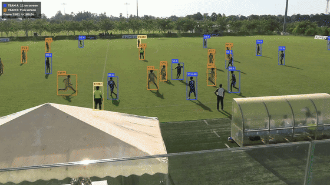
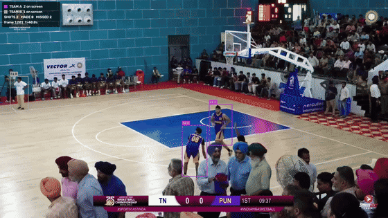
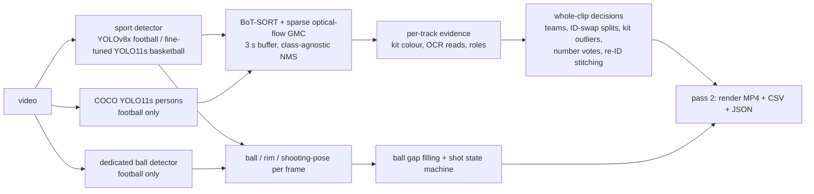
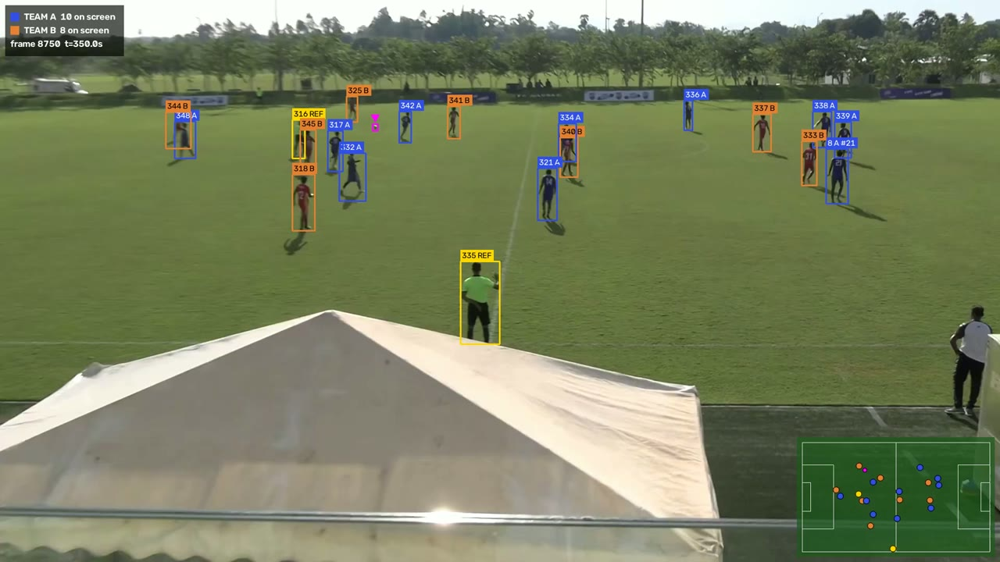
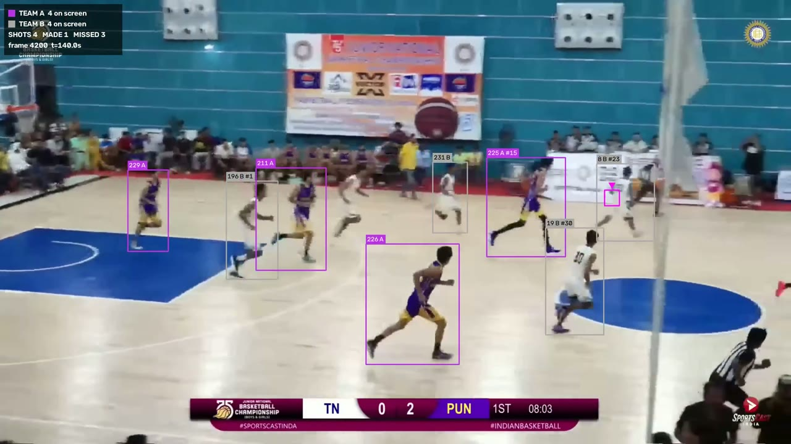
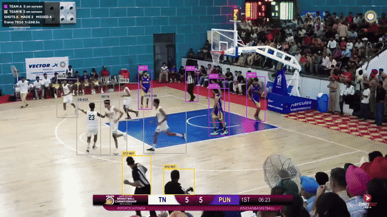

# SportsVision: tracking, teams, jersey numbers and shots in broadcast football & basketball

| Football: teams, persistent IDs, ball | Basketball: shot HUD, jersey numbers |
|---|---|
|  |  |

## Executive summary

`sportsvision` turns a broadcast clip into an annotated video plus per-frame tracking data:
players, referees and the ball are detected and tracked with persistent IDs, players are split
into teams without any labels, jersey numbers are read when legible, and basketball shot
attempts are detected and resolved as **made** or **missed**.

It is built for the constraint in the brief: one free Colab T4 (it was developed on a
**4 GB** laptop RTX 3050, a quarter of a T4's memory). Every heavy decision is made by
**voting over a whole track** instead of a heavier per-frame model:

1. **Pass 1, evidence.** Detectors + Ultralytics **BoT-SORT with camera-motion compensation**
   produce tracks, and every track collects cheap evidence: kit colour, jersey-number reads,
   ball / rim positions.
2. **Whole-clip decisions.** Team per track (KMeans on kit colour + majority vote), tracker
   ID swaps repaired (a track whose kit changes for good is split), re-identification by
   (team, jersey number), ball gaps filled, shots resolved.
3. **Pass 2, output.** The video is decoded again and rendered with stable labels, and the
   CSV/JSON are written.

| Clip | Frames | Identities | Team method | Jersey numbers | Shots | Speed (RTX 3050 4 GB) |
|---|---|---|---|---|---|---|
| Football U18, 10 min (05:00-15:00), 1080p25 | 15,001 | 629 (from 1,006 tracklets) | kit colour, k=2 | 8 identities | n/a | ~1.8 fps (3 detectors) |
| Basketball Junior Nationals, full 1st quarter (14:14), 4K→1080p30 | 25,613 | 1,088 (from 1,774 tracklets) | kit colour, k=2 | 44 identities | 21 attempts: 5 made / 16 missed | ~4.6 fps |

Deliverables: annotated MP4s, per-frame CSVs and summary JSONs are in the
[Google Drive folder](#artifact-links). Design research with 44 cited sources:
[docs/research.md](docs/research.md).

## Architecture



| Module | Responsibility |
|---|---|
| [`sportsvision/pipeline.py`](sportsvision/pipeline.py) | CLI, the two passes, whole-clip decisions, CSV / JSON |
| [`sportsvision/tracking.py`](sportsvision/tracking.py) | BoT-SORT + GMC configuration, ball outlier gating + gap interpolation |
| [`sportsvision/geometry.py`](sportsvision/geometry.py) | pitch template, RANSAC homography, camera-motion box warping |
| [`sportsvision/teams.py`](sportsvision/teams.py) | kit colour, KMeans teams, ID-swap detection, kit outliers |
| [`sportsvision/jersey.py`](sportsvision/jersey.py) | number locator + PARSeq reader, per-track vote, re-ID stitching |
| [`sportsvision/shots.py`](sportsvision/shots.py) | shot attempt / made / missed state machine |
| [`sportsvision/render.py`](sportsvision/render.py) | boxes, labels, HUD, H.264 writer (ffmpeg) |
| [`tools/train.py`](tools/train.py) | fine-tunes the basketball detector and the jersey-number locator |
| [`tools/eval_shots.py`](tools/eval_shots.py) | scores made-shot detection against the broadcast scoreboard |

## Architecture & tooling rationale

Short version: association, not detection, is what breaks sports tracking, and a free T4 has
no room for per-frame heavy models, so the design spends compute on **good detections + a
motion-compensated tracker**, then makes every label a **vote over the track**. Sources for
every number below are in [docs/research.md](docs/research.md).

### Detection

| Choice | Why | Alternatives considered |
|---|---|---|
| **Football: Roboflow `football-player-detection` (YOLOv8x @1280)**: player / goalkeeper / referee / ball | Trained on broadcast football; only open model with goalkeeper + referee classes | Generic COCO only: no referee / keeper roles |
| **+ COCO YOLO11s persons, gated by the sport model** | Measured: the Roboflow model (trained on high-angle Bundesliga, small players) misses players near this elevated camera, e.g. **3 vs 21 people** on frame 10,500. COCO finds every person; a COCO-only track is kept only if the sport model also saw it as a player on ≥10% of its frames, which rejects coaches and dugout substitutes | Lower inference size: inconsistent (3→7 people on one frame, no change on others) |
| **+ Roboflow `football-ball-detection` (YOLOv8x @1280)**, union with the player model's ball class | On 150 sampled frames: player model finds the ball in 29, ball model in 32, **union in 47**; the two agree on 13 of the 14 frames where both fire | SAHI slicing (4-60 passes/frame), WASB temporal model (separate training format) |
| **Basketball: YOLO11s fine-tuned** on Roboflow `basketball-player-detection-3` (654 NBA broadcast frames, CC BY 4.0; 11 classes collapsed to ball, ball-in-basket, player, player-shooting, referee, rim) | No usable public weights; the dataset has exactly the rim / ball-in-basket / shooting-pose classes shot detection needs. 960 px fits 4 GB | RF-DETR (heavier, hosted weights), avishah3 ball+hoop model (phone footage, no licence) |

Basketball detector, held-out test split (94 images):

| class | ball | ball-in-basket | player | player-shooting | referee | rim | **all** |
|---|---|---|---|---|---|---|---|
| mAP50 | 0.880 | 0.646 | 0.991 | 0.856 | 0.990 | 0.995 | **0.893** |
| mAP50-95 | 0.607 | 0.500 | 0.849 | 0.693 | 0.866 | 0.731 | **0.708** |

### Tracking and persistent IDs

* **BoT-SORT with sparse optical-flow GMC** (Ultralytics, version pinned). A broadcast pan
  moves every box at once; GMC warps the Kalman predictions by the estimated camera motion
  before matching. In like-for-like harnesses BoT-SORT beats ByteTrack on SportsMOT
  (73.8 vs 73.0 HOTA; 76.9 vs 67.9 in BoxMOT). Ultralytics ≥ 8.4.63 defaults to a different
  tracker, so `botsort.yaml` is passed explicitly and the version is pinned.
* **3 s track buffer** (default ~1 s) so short occlusions and pans keep the ID.
* **Class-agnostic NMS**: one body must not get both a `player` and a `player-shooting` /
  `goalkeeper` box (that spawned duplicate tracks).
* **ID-swap repair (`team_switches`)**: BoT-SORT fuses motion and appearance as
  `min(IoU cost, appearance cost)`, so ReID can add matches but never veto an overlap-driven
  swap. Instead, every track's kit colour is labelled per observation; when it flips to the
  other team and stays flipped for ~1 s, the tracker swapped people, so the track is split
  and the new person gets a new ID (brief occlusion noise is absorbed).
  A flip only splits when the box overlapped another box around it (swaps happen in
  occlusions; sun-to-shadow changes don't).
* **Re-identification by jersey number (`stitch_by_number`)**: tracklets with the same team
  and number that are never on screen together are one player, so a player who leaves the
  frame keeps their ID when they come back.
* **Appearance re-ID was tried and removed** (measured, not assumed): with generic ImageNet
  embeddings, same-player pairs had median cosine distance 0.020 but different teammates
  0.040, and 20% of teammate pairs were closer than 0.020, so any useful threshold merges
  wrong players. A sports-trained ReID model is the upgrade (licences: see roadmap).
* **Scene cuts** (PySceneDetect, BSD-3) split every track, stop ball interpolation and drop
  half-seen shots at camera cuts.
* Tracks shorter than 1 s are dropped (flicker, flagpoles, bench).

### Pitch registration (football)

Roboflow's `football-pitch-detection` keypoint model runs on every 5th frame; a RANSAC
homography (≥4 non-collinear keypoints, EMA-smoothed, held ≤10 frames) maps image → pitch
(template from roboflow/sports, MIT). It powers the **radar minimap** (bottom-right), the
`pitch_x/pitch_y` CSV columns, and an **on-pitch filter** that drops people whose feet stay
off the field (coaches, substitutes, spectators).

### Team classification

* **Kit colour = median Lab of the torso** (rows 15-55% of the box, grass masked by hue).
* **KMeans (k=2), lightness down-weighted ×0.25, majority vote per track.** Measured on this
  football clip: a red player in shadow had L=61, as dark as the blue team (L 50-65), while
  the kits differ in chroma (red a≈140/b≈145, blue a≈130/b≈122). Plain Lab clustering split
  by sunlight; weighting L fixed it (regression test `test_shadowed_player_is_grouped_by_kit_hue_not_brightness`).
  A published soccer pipeline reports 91.5% team accuracy for this CIELAB family of methods.
* **Goalkeepers** (own kit): team of the outfield players standing closest in the same frame.
* **Referees**: detector class; "players" whose kit matches neither team but matches the
  referees' kit become referees; other kit outliers (coaches, staff, spectators) are dropped.
* Why not SigLIP + UMAP (Roboflow's TeamClassifier): a ViT pass per crop on a 4 GB GPU for
  two kits that colour already separates; it is the documented upgrade for same-hue kits.

### Jersey numbers (football bonus; also on for basketball)

1. **Locate**: a YOLO11n "number locator" trained by `tools/train.py` on *player crops* from
   the basketball dataset's 2,855 number boxes (test mAP50 **0.979**, P 0.93, R 0.93). Trained
   on crops, it is sport-agnostic; "no number found" doubles as the legibility gate.
2. **Read**: PARSeq (docTR weights exported to ONNX by OnnxTR, Apache-2.0) on the tight box.
   On loose torso crops PARSeq produced garbage ("A", "€"); on located boxes it read the
   numbers cleanly. Published numbers agree: raw EasyOCR 11.3% vs gated PARSeq 80.5%.
3. **Vote**: ≥3 agreeing reads, >50% of the confidence mass, two-digit bias (a clipped "3"
   supports "32"). Budget: every 10th frame, ≤30 tries and ≤6 good reads per track.

### Basketball shots (`shots.py`)

A rule-based state machine (no shot-labelled training data exists for this footage):

* **attempt**: ball above the rim and within 2 rim widths sideways, or `ball-in-basket` at
  the rim. A preceding `player-shooting` pose (≥3 frames) backdates the attempt to the
  release, so "SHOT DETECTED" appears when the player goes up. A pose alone (pump fake)
  never creates an attempt.
* **made**: the ball crosses rim height downwards with the interpolated crossing inside the
  rim span, or `ball-in-basket` on ≥2 frames at the rim (one blip, or a ball logo on an ad
  board, is not enough).
* **missed**: crossing outside the rim, or no decision within 2.5 s. A 1 s cooldown stops a
  rebound counting twice.
* **Rim persistence**: when the rim detector loses the rim, its box is carried through the
  camera motion BoT-SORT already estimates (GMC warp per frame) for up to 3 s.

## Environment setup

**Colab (recommended for reviewers):** open
[`notebooks/colab_pipeline.ipynb`](notebooks/colab_pipeline.ipynb) in Colab, choose a T4 GPU
runtime and *Run all*. It installs the pinned dependencies, pulls the clips from the
assignment Drive folder (your Google account needs access), and runs both pipelines.

**Local:**

```bash
git clone https://github.com/Trafalgar-2006/foobasball.git && cd foobasball
python -m venv .venv && . .venv/bin/activate          # Windows: .venv\Scripts\activate
pip install torch torchvision --index-url https://download.pytorch.org/whl/cu126  # match your CUDA
pip install -r requirements.txt
python tools/download_weights.py                      # Roboflow football detectors (2 × 137 MB)
pytest -q                                             # 49 unit + integration tests
```

The fine-tuned basketball detector (19 MB) and jersey-number locator (5 MB) are committed in
`weights/`; PARSeq and COCO YOLO11s download automatically on first use. `ffmpeg` must be on
`PATH` (preinstalled on Colab).

## Inference pipeline

```bash
python -m sportsvision football   path/to/clip.mp4 --out outputs
python -m sportsvision basketball path/to/clip.mp4 --out outputs
```

| Option | Default | Meaning |
|---|---|---|
| `--imgsz` | 1280 football / 960 basketball | inference size |
| `--batch` | 4 | frames per detector batch |
| `--max-frames` | all | stop early (smoke tests) |
| `--no-jersey` | off | skip jersey-number recognition |
| `--reuse` | off | reuse `<clip>_evidence.pkl` from a previous run: skip detection, re-decide and re-render in minutes |

A TensorRT FP16 `X.engine` placed next to `X.pt` is picked up automatically (the Colab
notebook has a cell that builds them on the T4).

Preparing the assignment clips (any clip works as-is):

```bash
ffmpeg -ss 300 -t 600 -i football_full.mp4 -c copy football_10min.mp4            # 10-min window
ffmpeg -i basketball_full.mp4 -vf scale=1920:1080 -c:v libx264 -crf 18 -an basketball_1080p.mp4  # 4K -> 1080p
```

Re-training (optional, ~25 min on a 4 GB GPU; use `--imgsz 1280 --batch 8` on a T4):
`python tools/train.py --data-dir datasets`. Shot evaluation against the scoreboard:
`python tools/eval_shots.py basketball_1080p.mp4 outputs/basketball_1080p_summary.json`.

## Output format

| File | Content |
|---|---|
| `<clip>_annotated.mp4` | H.264; boxes coloured by team (kit hue), `ID team #number` labels, referees amber, ball magenta with marker, rims cyan; HUD with per-team on-screen counts and, for basketball, shots/made/missed + "SHOT DETECTED" / "RESULT: MADE/MISSED" banner |
| `<clip>_tracks.csv` | one row per object per frame (schema below) |
| `<clip>_summary.json` | metadata and timings, team kit colours, one entry per identity (class, team, number, first frame, frames, tracklets merged), shot list with times and outcomes, identity-repair statistics |

`frame_id, timestamp, track_id, class_name, x_min, y_min, x_max, y_max, confidence, team_id, jersey_number, event, shot_outcome, pitch_x, pitch_y`

* `pitch_x`, `pitch_y` (football): position on the pitch in cm (120 × 70 m template), from
  the feet for people and the centre for the ball; empty when no homography is available.

* `class_name`: `player`, `goalkeeper`, `referee`, `ball`, `rim`, or `event`.
* `track_id`: stable per identity; the ball is `0`; rims and events are `-1`.
* `confidence`: detector/tracker score; empty for interpolated ball positions.
* `team_id`: `A` / `B`, empty for referees and the ball.
* `event` / `shot_outcome` (basketball): an `event` row with `shot_attempt` at the attempt
  frame and `shot_result` + `made` / `missed` at the resolution frame.

## Performance analysis

### What works well

* **Teams.** Kits are split correctly in both clips. Boxes take a saturated version of each
  team's measured kit colour (blue / orange in football, purple / white in basketball).
  
* **Jersey numbers on basketball.** Numbers such as #23, #17, #30, #15, #5 are read and,
  through stitching, re-identified across re-entries (195 tracklets merged; #23 alone spans
  35 tracklets and 12,325 frames).
  
* **Pans.** GMC keeps IDs through camera pans (football GIF above).
* **Ball.** The two-detector union plus gap filling (≤0.4 s, physically impossible jumps
  rejected) keeps a usable ball track on the small football ball.
* **Clutter.** Foreground spectators (cut by the frame edge), dugout substitutes and coaches
  (never confirmed by the sport model) and ad-board ball logos are suppressed.

### Shots, measured against the scoreboard

The broadcast score bug is free ground truth: every score change is a made basket (+1 free
throw, +2/+3 field goal). `tools/eval_shots.py` reads both scores every 0.5 s with the same
PARSeq model (it reads the final 20-19 correctly) and keeps only changes that persist.

| | value |
|---|---|
| Real baskets (scoreboard) | 14 field goals + 9 free throws = 39 points |
| Attempts detected | 21 (5 made, 16 missed) |
| Detected makes confirmed by a score change | 2 of 5 (precision 0.40) |
| Field goals detected as made | 2 of 14 (recall 0.14) |

Rim persistence (carrying the rim through camera motion) was added after the first run and
re-measured: +1 attempt, no change in confirmed makes. It was not the bottleneck.



This is the weakest part of the system, and the cause was measured rather than guessed. In
the 5 s before each real field goal the **rim was visible in 4-57% of frames, and the ball
was never detected near the rim in 12 of 14 cases**. This camera sits low in the stands, far
from the hoop, and the airborne ball against the crowd behind the backboard is a few blurred
pixels. The detector was trained on high NBA camera angles. Re-running detection on an
upscaled crop around the rim recovered **0** extra balls over 134 hoop frames, so the fix is
data (see Future work), not thresholds. When the ball *is* visible near the rim, the state
machine resolves the shot as designed (both confirmed makes, 262 s and 431 s).

### Speed (RTX 3050 Laptop, 4 GB)

| | pass 1 (detect + track) | pass 2 (render) |
|---|---|---|
| Basketball (YOLO11s @960 + number OCR + scene detection) | 5.0 fps (85 min) | 56 fps (8 min) |
| Football (2 × YOLOv8x @1280 + YOLO11s + pitch keypoints) | 1.9 fps (132 min) | 57 fps (4 min) |

Measured on the final runs, with **both clips processed at the same time on the one GPU**, so
each number is a lower bound. A T4 has 4× the memory and roughly 2× the throughput of this
GPU; the notebook's TensorRT FP16 cell is the next speed-up.

### Coverage (football)

* Pitch homography available on **93%** of frames (radar + `pitch_x/pitch_y` for 93% of
  person rows).
* Ball position (detected or interpolated) on **51%** of frames; the rest are mostly frames
  where the ball is genuinely out of view or a few pixels against the crowd.
* Identity repair: 107 ID-swap splits, 72 kit outliers (coaches, staff) removed or turned
  into referees.

## Failure modes & edge cases

1. **Shot recall on low, far cameras** (above): the ball near the rim is undetected, so most
   makes are missed or never become attempts. Free throws are treated like any other shot.
2. **ID fragmentation under panning.** A player who leaves the frame and returns gets a new
   ID unless their number was read (football players are mostly too small to read).
   Identities per clip: 629 in 10 min of football (only 8 with a read number, 13 merges),
   1,088 in the basketball quarter; a real roster is ~30 people per clip.
3. **ID-swap splits** trade one wrong label for an extra ID; in crowded basketball paint
   this happens often (361 splits in the basketball quarter).
4. **Football detector domain shift**: fixed by the COCO merge, at the cost of a third
   detector (~2 fps on 4 GB).
5. **Referees** are only recovered when the sport model labels a referee at least sometimes;
   kit outliers that match no referee are dropped rather than mislabelled. The reverse also
   happens: a courtside photographer dressed in black matches the referees' kit and is
   labelled `REF` (basketball, ~262 s).
6. **Goalkeeper team** uses image-x proximity; wrong if only attackers are near the keeper.
7. **Ball**: a confidence-only pick per frame; a ball-shaped logo can win while the real ball
   is occluded. Gaps longer than 0.4 s are left empty.
8. **Kit colour** assumes the two kits differ in hue; same-hue kits or strongly coloured
   lighting need embeddings.
9. **Scene cuts** are detected and split every track, so each cut costs new IDs unless a
   jersey number re-links them; replays are not told apart from live play.

Each deliberate shortcut is marked in the code with a `# ponytail:` comment naming its limit
and upgrade trigger (7 markers).

## Future work

The full ranked plan, with proposed test seams, verification metrics and a licence register,
is in [docs/roadmap.md](docs/roadmap.md). Headlines:

1. **Shot detection data, not rules**: auto-label ball and rim on *this* camera using
   scoreboard timestamps as weak supervision, fine-tune, and add a temporal ball model
   (WASB). The shot clock above the backboard (resets on makes) and the score bug are strong
   extra signals to fuse.
2. **Identity**: a sports-trained appearance ReID (generic ImageNet features were measured
   useless) plus offline GTA-style tracklet association constrained by team and number;
   court homography for basketball; pitch position for goalkeeper teams.
3. **Speed**: build the TensorRT FP16 engines by default and batch the OCR crops.
4. **Teams**: SigLIP + UMAP embeddings when kits share a hue.
5. **Jersey numbers**: fine-tune PARSeq on SoccerNet jersey crops (+7 points published).

## Artifact links

* Google Drive (annotated videos, CSVs, JSONs): **TBD link**
* Colab notebook: [`notebooks/colab_pipeline.ipynb`](notebooks/colab_pipeline.ipynb)

## Repository layout

```
sportsvision/   pipeline package (python -m sportsvision ...)
tools/          train.py, download_weights.py, eval_shots.py
tests/          49 unit + integration tests (pytest; CI in .github/workflows)
notebooks/      Colab runner
weights/        fine-tuned basketball detector + jersey-number locator
docs/           research report, README assets
```

## Credits and licences

Roboflow [sports](https://github.com/roboflow/sports) football weights (MIT);
`basketball-player-detection-3` dataset (CC BY 4.0, Roboflow Universe, HF mirror
`koppolusameer/basketball-coco-20260416`); PARSeq via
[OnnxTR](https://github.com/felixdittrich92/OnnxTR) (Apache-2.0);
[Ultralytics](https://github.com/ultralytics/ultralytics) YOLO / BoT-SORT (AGPL-3.0). This
repository is released under the same licence: [AGPL-3.0](LICENSE).
